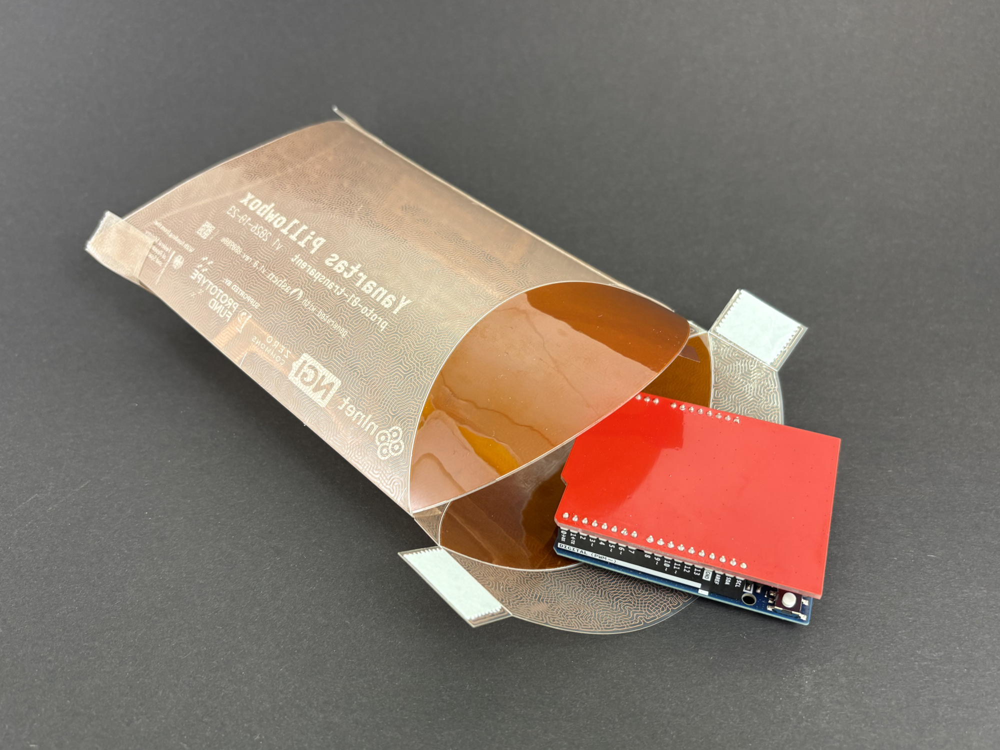

# Yanartas Pillowbox Prototype Designs

This repo contains prototype tamper-sensing meshes designed using the [Yanartas Pillowbox
Generator](https://git.yasec.de/yasec/yanartas-pillowbox-generator).

## Repository Contents

### `proto-01-transparent`
**version:** `v1 2026-10-23`

`proto-01-transparent` is the first physical protoype of a generated mesh. This protoype uses two layers with two mesh
segments each for four total segments. Each segment uses two mesh traces for a total of 16 mesh traces across both
layers.

The prototype is designed to be produced using the transparent flexible substrate offered by
[JLCPCB](https://jlcpcb.com). The traces are intentionally laid out without a ground plane and using thin traces with a
very wide spacing so that the finished mesh stays transparent.

License
-------

© 2026 Dr.-Ing. Jan Sebastian 'jaseg' Götte

This project is licensed [CERN-OHL-S v2](https://ohwr.org/cern_ohl_s_v2.txt).

LLM/AI Policy
-------------

This project does not accept LLM-generated contributions.

## Funding

Part of this project is funded by the nlnet [NGI0 Commons Fund](https://nlnet.nl/commonsfund/) as part of the [Yanartas
project](https://nlnet.nl/project/Yanartas/).

